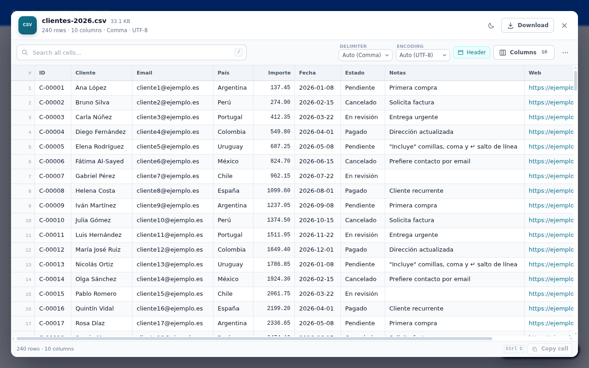
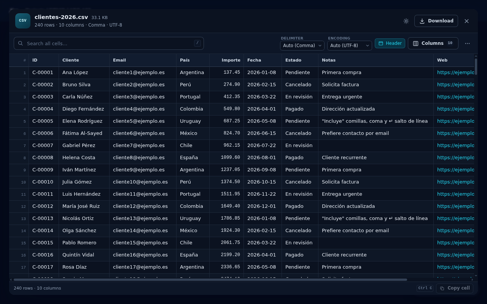
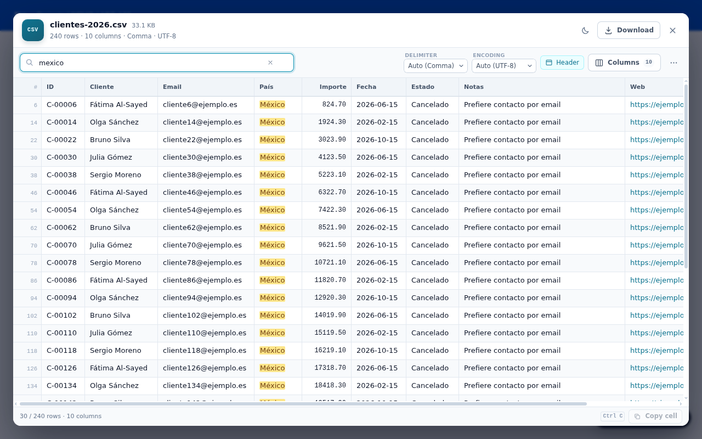
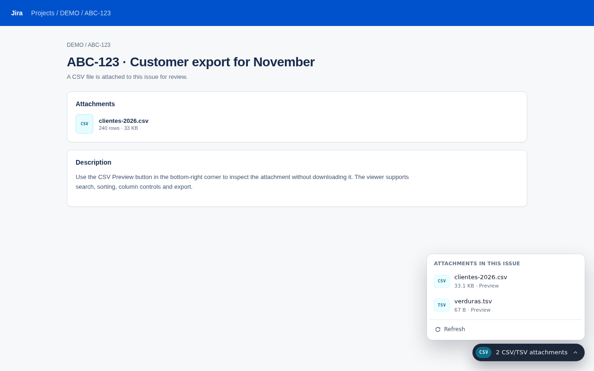

# CSV Preview for Jira

Extensión de Chrome (Manifest V3) que detecta los adjuntos **CSV** y **TSV** de una incidencia de Jira y los abre en un visor de tabla, sin descargarlos ni salir de la incidencia.

La interfaz está en **inglés por defecto** y se localiza automáticamente a **español de Argentina** y **portugués de Brasil** según el idioma de Chrome.



## Qué hace

- Detecta la incidencia que estás viendo (Jira Cloud, Data Center o Server) y consulta su lista de adjuntos.
- Muestra un botón flotante **CSV** en la esquina inferior derecha cuando hay adjuntos `.csv` o `.tsv`.
- Si hay varios, abre un menú para elegir cuál ver.
- Abre el archivo en un diálogo amplio sobre la incidencia, con:
  - tabla virtualizada (soporta archivos grandes sin bloquear la página);
  - búsqueda en todas las celdas, con normalización de acentos (`mexico` encuentra `México`);
  - ordenación por columna, con detección de columnas numéricas;
  - anchos de columna ajustables y ajuste automático;
  - mostrar u ocultar columnas;
  - primera fila como encabezado, configurable;
  - detección automática de separador (coma, punto y coma, tabulador, barra vertical) y codificación (UTF-8, Windows-1252, UTF-16 con BOM), con selector manual;
  - selección de celdas con teclado y copia de la celda actual (`Ctrl/Cmd + C`);
  - doble clic en una celda para ver el valor completo;
  - copiar toda la vista como TSV o exportar la vista filtrada como CSV;
  - tema claro/oscuro que sigue el tema de Jira (o el que elijas);
  - descarga del archivo original desde el propio visor.
- Añade un popup en el icono de la extensión con los CSV de la incidencia actual.
- Incluye una página de demostración con datos de ejemplo para probar el visor sin una cuenta de Jira.
- Es compatible con **Markdown Preview for Jira**: si ambos botones flotantes están presentes, el de CSV se apila arriba para no tapar el de Markdown.
- Atajo `Ctrl + Shift + Y` para abrir el visor desde el teclado.



La búsqueda ignora acentos y mayúsculas, y resalta las coincidencias:



Con varios adjuntos, el botón abre un menú para elegir el archivo:



## Instalar en modo desarrollador

1. Descarga o clona esta carpeta.
2. Abre `chrome://extensions`.
3. Activa **Modo de desarrollador** (arriba a la derecha).
4. Pulsa **Cargar descomprimida** y elige la carpeta que contiene `manifest.json`.
5. Abre una incidencia de Jira con un adjunto `.csv` o `.tsv`. Aparecerá el botón **CSV** en la esquina inferior derecha.

No hay paso de compilación: la extensión se carga tal cual.

También hay una demo pública del visor, sin instalar la extensión ni tener Jira:

**https://xenner.github.io/jira-csv-preview/demo.html**

## Uso

| Situación | Qué ocurre |
| --- | --- |
| Incidencia con un CSV | El botón muestra el nombre del archivo; al pulsarlo se abre el visor. |
| Incidencia con varios CSV/TSV | El botón muestra el número de adjuntos; al pulsarlo aparece el menú para elegir. |
| Icono de la extensión | Lista los adjuntos CSV de la pestaña activa y permite abrirlos. |
| `Ctrl + Shift + Y` | Abre el visor o el menú de adjuntos. |
| `Esc` | Cierra el visor, el diálogo o el menú. |
| `Ctrl/Cmd + F` o `/` | Enfoca la búsqueda dentro del CSV. |
| `Ctrl/Cmd + C` | Copia la celda seleccionada. |

### Jira Cloud, Data Center y dominios propios

Jira Cloud (`*.atlassian.net`, `*.atlassian.com`, `*.jira.com`) funciona de forma predeterminada.

Para Jira Data Center o una instalación en un dominio propio:

1. Abre **Ajustes** desde el popup de la extensión.
2. En **Sitios de Jira**, escribe la URL base, por ejemplo `https://jira.miempresa.com` o `https://jira.miempresa.com/jira`.
3. Concede el permiso y recarga las pestañas de Jira que ya tengas abiertas.

La extensión prueba primero la API v3 y, si no existe, la API v2. También entiende las instalaciones con context path (`/jira`).

## Permisos

| Permiso | Para qué se usa |
| --- | --- |
| `storage` | Guardar tema, densidad, tamaño de texto y los sitios adicionales. |
| `scripting` | Registrar el content script en los dominios de Jira que añadas en ajustes. |
| `*://*.atlassian.net/*`, `*://*.atlassian.com/*`, `*://*.jira.com/*` | Consultar los adjuntos de la incidencia y descargar el archivo que pides previsualizar. |
| `*://*/*` (opcional, desactivado) | Solo para instalaciones que sirven los adjuntos desde otro dominio (por ejemplo, S3). Se activa y se revoca en ajustes. |

La extensión no usa analíticas, no tiene servidores y no envía datos a ningún sitio. Las únicas peticiones son a tu propio Jira: la lista de adjuntos de la incidencia y el archivo que decides abrir, usando tu sesión existente.

## Cómo funciona

1. El **content script** detecta la clave de la incidencia desde la URL (`/browse/ABC-123`, `?selectedIssue=ABC-123`, etc.) o desde el DOM.
2. El **service worker** consulta `GET /rest/api/3/issue/{key}?fields=attachment` (y prueba v2 si hace falta).
3. Si hay adjuntos `.csv`/`.tsv`, el content script muestra el botón flotante.
4. Al abrir uno, el service worker descarga el archivo con `credentials: include`, siguiendo la redirección al host de medios de Jira si existe.
5. El archivo se pasa al visor (`viewer.html`), que se muestra en un iframe con Shadow DOM para que los estilos de Jira no lo alteren.
6. El visor analiza el CSV con [Papa Parse](https://www.papaparse.com/) (incluido localmente) y renderiza solo las filas visibles.

El visor es una página de la extensión, sin acceso a la red: todo el análisis ocurre en el navegador.

## Límites conocidos

- Tamaño máximo por archivo: **20 MB**. El límite está en `src/background.js`.
- Solo se detectan adjuntos con extensión `.csv` o `.tsv`. Los CSV dentro de un ZIP, o pegados en la descripción, no se procesan.
- La lista de adjuntos depende de que tu usuario pueda acceder a la API REST de Jira. Si la API está restringida, se intenta un modo de respaldo leyendo enlaces de adjuntos del DOM.
- La detección automática del separador cubre coma, punto y coma, tabulador y barra vertical. Para separadores exóticos, usa el selector manual de la barra de herramientas.
- La detección de codificación automática distingue UTF-8 de Windows-1252. Algunos archivos ambiguos pueden necesitar el selector manual.
- No se interpretan fórmulas ni se modifican los datos. La exportación conserva los valores originales.
- No está afiliada, respaldada ni patrocinada por Atlassian. Jira es una marca registrada de Atlassian Pty Ltd.

## Desarrollo

No hay bundler ni dependencias de ejecución. Para probar el visor sin cargar la extensión:

```bash
cd jira-csv-preview
python3 -m http.server 8765
# abre http://127.0.0.1:8765/test/harness.html
```

`test/harness.html` carga `viewer.html` en un iframe y le pasa `test/fixture.csv` con el mismo protocolo de mensajes que usa la extensión. Hay archivos de prueba para punto y coma, TSV, una sola columna, Windows-1252, BOM, solo encabezados y 40 columnas.

Para probar la extensión completa con una incidencia simulada, sirve `test/` y monta un sitio de prueba en un dominio que coincida con los permisos, o carga la extensión y abre una incidencia real.

### Estructura

```
manifest.json              Manifest V3
viewer.html                visor (iframe)
demo.html                  página de demostración con una incidencia simulada
demo/sample.csv            CSV de ejemplo para la demo
src/
  background.js            service worker: REST + descarga de adjuntos
  content.js               detección de la incidencia, botón y diálogo
  content.css              estilos del botón y del menú
  viewer.js                parser, tabla virtualizada y controles
  viewer.css               estilos del visor
  i18n.js                  helper de internacionalización de las páginas
_locales/                  mensajes en, es, es_419 y pt_BR
options/
  popup.html / popup.js    popup del icono
  options.html / options.js ajustes y sitios adicionales
  ui.css                   estilos compartidos
vendor/
  papaparse.min.js         parser CSV (MIT)
  PAPAPARSE-LICENSE.txt
icons/                     iconos 16/32/48/128 y SVG fuente
test/                      harness y archivos de prueba
screenshots/               capturas para la documentación
CHROME-WEB-STORE-LISTING.md    ficha de Store en español
CHROME-WEB-STORE-LISTING-EN.md ficha de Store en inglés
PRIVACY.md / PRIVACY-EN.md     política de privacidad
THIRD_PARTY_NOTICES.md     atribuciones de terceros (Markdown Preview for Jira, Papa Parse)
privacy.html               política lista para publicar en una URL pública
PUBLISHING.md              guía paso a paso para Chrome Web Store
```

### Cambiar el tamaño máximo

Edita `MAX_BYTES` en `src/background.js`. El visor muestra un error claro si el archivo lo supera y ofrece descargarlo.

### Empaquetar para la Chrome Web Store

```bash
cd jira-csv-preview
zip -r ../jira-csv-preview-1.1.3.zip \
  manifest.json viewer.html src options vendor icons _locales \
  README.md PRIVACY.md PRIVACY-EN.md LICENSE
```

También puedes usar `chrome://extensions` → **Empaquetar extensión**.

## Inspiración y atribuciones

La idea de mostrar los adjuntos con un botón flotante y abrirlos en un visor sobre la incidencia está inspirada en **Markdown Preview for Jira**, de Fahri (MIT):

- https://github.com/FahreddinHepdonduran/markdown-preview-for-jira

No es un fork ni está afiliada a ese proyecto. La atribución completa y la licencia están en `THIRD_PARTY_NOTICES.md`.

## Idiomas

Los textos de la interfaz viven en `_locales/`:

- `en`: inglés, idioma predeterminado.
- `es`: español de Argentina.
- `es_419`: español de Latinoamérica, con el mismo texto argentino.
- `pt_BR`: portugués de Brasil.

Chrome elige el idioma según la configuración de la interfaz del navegador. Si el idioma no está soportado, usa inglés. Para agregar otro idioma, copiá `_locales/en/messages.json`, traducilo y agregá la carpeta con el código de locale correspondiente.

## Licencia

MIT. Consulta [LICENSE](LICENSE). Papa Parse se distribuye bajo licencia MIT; su aviso está en `vendor/PAPAPARSE-LICENSE.txt`.
